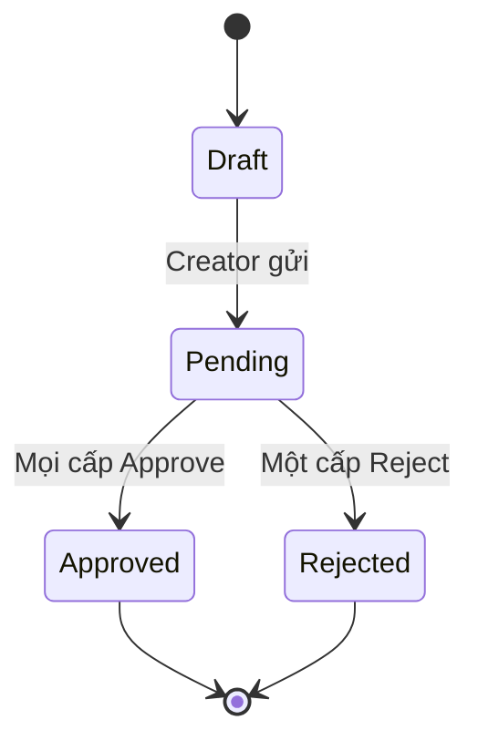
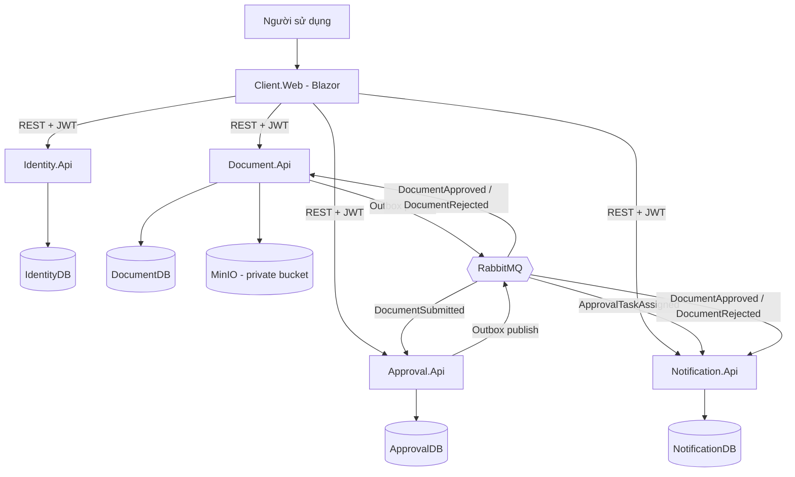
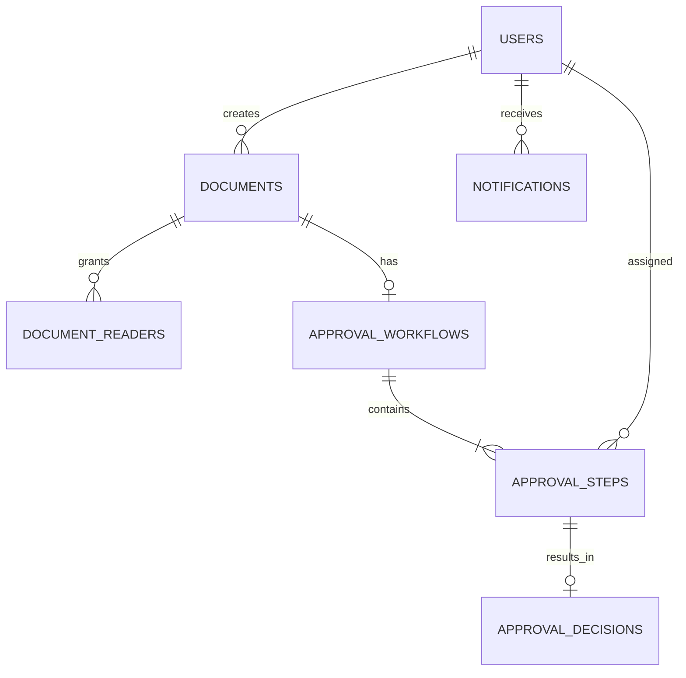

# PHÂN TÍCH VÀ ĐẶC TẢ DỰ ÁN

## HỆ THỐNG PHÊ DUYỆT TÀI LIỆU PHÂN TÁN

**Tên tiếng Anh:** Distributed Document Approval System

**Tên repository/thư mục:** `DistributedDocApproval`

**Học phần:** Phát triển ứng dụng phân tán

**Định hướng:** Bài tập lớn có sản phẩm hoạt động thực tế, triển khai được bằng Docker Compose

**Phiên bản đặc tả:** 1.0 — 24/11/2026
**Trạng thái:** Đề xuất thiết kế trước khi triển khai, không phải kết quả đã lập trình

---

## 1. CĂN CỨ VÀ NGUYÊN TẮC THIẾT KẾ

### 1.1. Yêu cầu bắt buộc theo hướng dẫn bài tập lớn

Tài liệu hướng dẫn chung mà người thực hiện cung cấp xác định các yêu cầu:

1. Sử dụng **C#** và nền tảng **.NET 10**.
2. Xây dựng API bằng **ASP.NET Core Minimal API**.
3. Có **Console App hoặc Web App** làm client.
4. Sử dụng cơ chế giao tiếp phù hợp (REST, SignalR, gRPC, RabbitMQ hoặc tương đương).
5. Có sơ đồ dữ liệu và sơ đồ giao tiếp giữa các thành phần.
6. Quản lý mã nguồn bằng Git.
7. Các service được tổ chức để chạy độc lập theo kiến trúc lựa chọn.
8. **Mỗi service .NET có Dockerfile riêng**.
9. Có tệp **`docker-compose.yml`** khởi chạy toàn hệ thống.
10. Các container giao tiếp qua Docker network bằng **service name**.
11. Cấu hình phụ thuộc môi trường (connection string, message broker, service URL, port) được tách khỏi mã nguồn.
12. Có logging để theo dõi xử lý xuyên các thành phần chính.
13. Có cách duy trì hoạt động phù hợp hoặc phục hồi khi một thành phần tạm dừng, theo đặc điểm của đề tài.
14. Nộp báo cáo đầy đủ, GitHub repository chứa tất cả mã nguồn và cấu hình, README hướng dẫn cài đặt/build/chạy, các sơ đồ và minh họa cần thiết; có thể chạy và giải thích hệ thống khi trình bày.

**Lưu ý:** Giảng viên không bắt buộc cụ thể PostgreSQL, Blazor, RabbitMQ, MinIO hay số lượng microservice. Đây là lựa chọn thiết kế được đề xuất để đáp ứng các tiêu chí phía trên.

### 1.2. Quyết định phạm vi đã chốt

- Chỉ có **3 vai trò**: `Admin`, `Creator` (Người tạo), `Approver` (Người duyệt).
- Không tạo thêm các vai trò Giám đốc, Kế toán, Kiểm toán, Trưởng phòng. Nếu cần nhiều cấp, dùng nhiều **tài khoản có cùng vai trò Approver** và thứ tự phê duyệt.
- Chỉ có **4 trạng thái tài liệu** mà người dùng nhìn thấy: `Draft`, `Pending`, `Approved`, `Rejected`.
- Phê duyệt **tuần tự**; mặc định demo 2 cấp, kiến trúc hỗ trợ cấu hình 1–3 cấp, **không** phê duyệt song song trong MVP.
- Một tài liệu có **một file đính kèm chính** (PDF hoặc DOCX), không xây dựng hệ thống lưu phiên bản phức tạp ở MVP.
- Kết quả phê duyệt là **Approve** hoặc **Reject**; chưa có chức năng yêu cầu sửa trực tiếp trong luồng. Khi bị từ chối, người tạo lập tài liệu mới hoặc bản nháp mới để gửi lại.
- Mỗi người chỉ được truy cập nội dung tài liệu mà mình tạo hoặc được chỉ định phê duyệt. Quyền Admin không tự động cho phép mở file riêng tư của tất cả người dùng.
- Giao diện Web là ưu tiên, không cần ứng dụng điện thoại, chữ ký số có giá trị pháp lý hay email ở giai đoạn chính.

### 1.3. Nguyên tắc cân bằng chất lượng và độ phức tạp

- Đủ tách biệt để thể hiện microservices, nhưng không chia thành quá nhiều service nhỏ.
- Nghiệp vụ phải đúng trước; giao diện đẹp và tính năng mở rộng làm sau.
- Mỗi bước triển khai phải chạy được, kiểm thử được, rồi mới chuyển bước tiếp theo.
- Mỗi service **sở hữu dữ liệu**, các service khác không được truy vấn thẳng bảng của service đó.
- Không đánh đồng “nhiều container” với “hệ thống tự chịu lỗi”: khả năng phục hồi phải được thiết kế và kiểm thử.
- Ưu tiên giải pháp dễ dựng lại từ GitHub trên Windows + Docker Desktop.

---

## 2. MÔ TẢ BÀI TOÁN

### 2.1. Bối cảnh

Trong doanh nghiệp hoặc đơn vị đào tạo, một đề nghị, biểu mẫu hay báo cáo thường phải được người có trách nhiệm kiểm tra trước khi được chấp thuận. Nếu xử lý bằng email hoặc file gửi qua lại, khó xác định ai đang giữ nhiệm vụ, tài liệu đã duyệt đến đâu và lịch sử quyết định có đầy đủ không.

Hệ thống giải quyết bài toán bằng cách cho người tạo tải file lên, chọn người duyệt theo thứ tự, gửi yêu cầu, theo dõi trạng thái và nhận thông báo. Mỗi quyết định được lưu kèm thời gian, người thực hiện và ghi chú.

### 2.2. Mục tiêu chức năng

1. Đăng nhập, phân quyền phù hợp.
2. Tạo, xem, tìm và tải lại tài liệu trong phạm vi được phép.
3. Gửi tài liệu cho danh sách người duyệt có thứ tự.
4. Xử lý phê duyệt/từ chối đúng thứ tự, không cho phê duyệt trùng.
5. Theo dõi tiến độ, lịch sử và thông báo.
6. Có dữ liệu mẫu để demo một quy trình phê duyệt từ đầu đến cuối.

### 2.3. Mục tiêu kỹ thuật phân tán

1. Các API là những process/container độc lập.
2. REST phục vụ truy cập từ web; RabbitMQ truyền sự kiện nghiệp vụ giữa các service.
3. Mỗi service quản lý database riêng (có thể dùng cùng một PostgreSQL server để tiết kiệm tài nguyên).
4. Lưu sự kiện theo **Transactional Outbox**, tiếp nhận theo **Inbox/Idempotent Consumer**.
5. Log có `CorrelationId`, `EventId`, `DocumentId` ở các điểm liên quan.
6. Tạm dừng Notification API không làm mất quyết định phê duyệt; sau khi hoạt động lại, thông báo được tiếp tục xử lý.
7. Khi RabbitMQ không sẵn sàng, dữ liệu nghiệp vụ và bản ghi sự kiện vẫn được lưu trong DB, rồi phát lại khi broker trở lại.
8. Demo cách khôi phục sau sự cố, không khẳng định hệ thống vẫn xử lý mọi tác vụ khi một phụ thuộc bắt buộc ngừng chạy.

### 2.4. Tiêu chí nghiệm thu tổng quát

Một người mới có thể clone repository, cấu hình `.env`, chạy `docker compose up --build -d`, mở Web App, đăng nhập tài khoản demo, tạo tài liệu PDF/DOCX, gửi duyệt qua 2 người theo thứ tự, nhận kết quả, xem thông báo và lịch sử. Sau đó có thể thử dừng một service, khởi động lại và kiểm chứng cách hệ thống phục hồi mà không làm mất dữ liệu đã commit.

---

## 3. TÁC NHÂN VÀ PHÂN QUYỀN (RBAC)

### 3.1. Chỉ 3 vai trò

| Vai trò | Trách nhiệm |
|---|---|
| **Admin** | Quản lý danh sách tài khoản, kích hoạt/vô hiệu hóa tài khoản, gán 1 trong 3 vai trò, kiểm tra log hệ thống không chứa file riêng tư. Không được phê duyệt thay người khác. |
| **Creator** | Tạo bản nháp, tải file, sửa/xóa bản nháp của mình, chọn người duyệt hợp lệ, gửi phê duyệt, xem tiến độ và kết quả của tài liệu mình tạo. |
| **Approver** | Xem tài liệu được chỉ định, xem danh sách nhiệm vụ, phê duyệt hoặc từ chối nhiệm vụ đang đến lượt mình, xem lịch sử liên quan. |

**Để giữ MVP đơn giản, mỗi tài khoản có một vai trò chính.** Nếu sau này cần một người vừa tạo vừa duyệt thì mở rộng nhiều vai trò/tài khoản, không thay đổi quy tắc dữ liệu cốt lõi.

### 3.2. Ma trận quyền

| Hành động | Admin | Creator | Approver |
|---|:---:|:---:|:---:|
| Đăng nhập, xem hồ sơ của mình | ✓ | ✓ | ✓ |
| Quản lý người dùng và vai trò | ✓ | — | — |
| Xem log vận hành/quản trị cần thiết | ✓ | — | — |
| Tạo tài liệu, tải file lên | — | ✓ | — |
| Sửa/xóa bản nháp do mình tạo | — | ✓ | — |
| Gửi tài liệu đi phê duyệt | — | ✓ | — |
| Xem/tải tài liệu mình tạo | — | ✓ | — |
| Xem/tải tài liệu được chỉ định duyệt | — | — | ✓ |
| Quyết định Approve/Reject ở đúng bước | — | — | ✓ |
| Xem tiến độ/lịch sử liên quan | — | ✓ | ✓ |
| Xem thông báo của bản thân | ✓ | ✓ | ✓ |

**Quy tắc bắt buộc:** Kiểm tra quyền trong backend tại từng API và từng bản ghi, không chỉ ẩn nút trên UI; trả về 404/403 phù hợp để tránh làm lộ tài liệu của người khác.

### 3.3. Quyền truy cập file khi chia nhiều service

`Document.Api` cần tự kiểm tra quyền download. Vì `Approval.Api` sở hữu danh sách nhiệm vụ, không được cho `Document.Api` truy vấn thẳng DB của Approval. Đề xuất **lưu danh sách quyền xem tài liệu (`DocumentReaders`) ngay lúc gửi phê duyệt**, gồm các Approver đã được chọn và kiểm tra là hợp lệ. Creator luôn có quyền với tài liệu của mình. `Approval.Api` riêng biệt vẫn kiểm tra quyền **ra quyết định** theo đúng `ApproverId` và bước đang hoạt động.

Như vậy: người được chỉ định ở bước sau có thể xem tài liệu trước khi đến lượt, nhưng **chưa được phê duyệt**. Đây là quyết định có chủ đích để giảm coupling và dễ giải thích; nếu cần hạn chế quyền xem theo từng bước, có thể thêm event cấp/thu hồi quyền trong phiên bản sau.

---

## 4. PHẠM VI CHỨC NĂNG VÀ USE CASE

### 4.1. Phân nhóm chức năng

**Nhóm F1 — Tài khoản**
- `F1.1` Đăng nhập bằng email/tên đăng nhập và mật khẩu.
- `F1.2` Đăng xuất; kiểm tra phiên làm việc.
- `F1.3` Admin tạo/kích hoạt/vô hiệu hóa tài khoản, gán vai trò.
- `F1.4` Hiển thị danh sách người duyệt hợp lệ cho Creator lựa chọn.

**Nhóm F2 — Tài liệu**
- `F2.1` Tạo bản nháp với tiêu đề, mô tả và một file PDF/DOCX.
- `F2.2` Xem danh sách bản thân tạo, tìm theo tiêu đề/trạng thái/ngày.
- `F2.3` Xem chi tiết, tải file trong phạm vi có quyền.
- `F2.4` Sửa/xóa bản nháp của mình.
- `F2.5` Gửi bản nháp cho 1–3 người duyệt theo thứ tự.

**Nhóm F3 — Phê duyệt**
- `F3.1` Tạo quy trình từ sự kiện `DocumentSubmitted`.
- `F3.2` Hiển thị danh sách nhiệm vụ đang chờ đến lượt người duyệt.
- `F3.3` Approve/Reject có ghi chú.
- `F3.4` Tự chuyển sang người tiếp theo khi bước hiện tại được chấp thuận.
- `F3.5` Hoàn thành Approved khi tất cả bước được chấp thuận; Rejected ngay khi một bước từ chối.
- `F3.6` Xem tiến độ và lịch sử quyết định.

**Nhóm F4 — Thông báo và vận hành**
- `F4.1` Thông báo khi được giao nhiệm vụ phê duyệt.
- `F4.2` Thông báo khi tài liệu được phê duyệt hoặc bị từ chối.
- `F4.3` Đánh dấu thông báo đã đọc.
- `F4.4` Log hệ thống, health check, kiểm thử sự cố.

### 4.2. Use case trọng tâm

**UC01 — Người tạo gửi tài liệu**
- Tiền điều kiện: Creator đăng nhập; tài liệu đang `Draft`; có file hợp lệ; chọn 1–3 tài khoản Approver còn hiệu lực, không trùng nhau.
- Luồng chính: Tạo/sửa bản nháp → chọn thứ tự người duyệt → bấm Gửi → API xác thực và kiểm tra phiên bản → cập nhật `Pending` + lưu Outbox cùng transaction → sau đó event được chuyển sang Approval Service.
- Hậu điều kiện: tài liệu khóa chỉnh sửa, tồn tại lịch sử gửi; quá trình phê duyệt có thể được tạo trễ trong trường hợp broker tạm ngừng.
- Ngoại lệ: file không hợp lệ (400/422); chưa đăng nhập (401); không sở hữu tài liệu (403/404); đã gửi (409); không xác thực được người duyệt do Identity Service tạm lỗi (503, **chưa thay đổi trạng thái**).

**UC02 — Người duyệt phê duyệt**
- Tiền điều kiện: Approver đăng nhập; nhiệm vụ gắn với tài khoản; bước hiện tại đang active; quy trình `Pending`.
- Luồng chính: Mở inbox → đọc file → chọn Approve → ghi nhận xét tùy chọn → API commit quyết định → kích hoạt bước kế tiếp, hoặc hoàn thành quy trình và phát event kết quả.
- Hậu điều kiện: không còn nhiệm vụ đang chờ của bước vừa duyệt; tất cả lần thao tác đều có lịch sử.
- Ngoại lệ: sai người duyệt (403/404); nhiệm vụ chưa đến lượt/đã xử lý (409); hai yêu cầu đồng thời chỉ một yêu cầu thành công.

**UC03 — Người duyệt từ chối**
- Tiền điều kiện: Như UC02.
- Luồng chính: Chọn Reject, **bắt buộc nhập lý do** → quy trình kết thúc `Rejected` → phát event → Document cập nhật tài liệu → Notification tạo thông báo cho Creator.
- Hậu điều kiện: không còn bước nào được tiếp tục. Người tạo muốn gửi lại phải tạo tài liệu mới, không chỉnh sửa tài liệu đã từ chối.

**UC04 — Xem lịch sử và trạng thái**
- Creator xem lịch sử các tài liệu do mình tạo; Approver xem lịch sử tài liệu mà mình được chỉ định. Dữ liệu từ `Document.Api` (metadata/file) và `Approval.Api` (tiến độ, quyết định) được Client tổng hợp qua API, không JOIN trực tiếp giữa database.

**UC05 — Admin quản lý tài khoản**
- Admin tạo tài khoản/đổi vai trò/vô hiệu hóa tài khoản. Nếu một approver đã được gán nhiệm vụ rồi bị vô hiệu hóa, MVP không tự gán lại; Admin kích hoạt lại tài khoản hoặc xử lý thủ công trong demo. Cơ chế chuyển giao nhiệm vụ là ngoài phạm vi.

---

## 5. QUY TRÌNH NGHIỆP VỤ VÀ TRẠNG THÁI

### 5.1. Trạng thái tài liệu hiển thị

| Trạng thái | Ý nghĩa | Được sửa file? |
|---|---|:---:|
| `Draft` | Bản nháp chưa gửi | Có, bởi Creator sở hữu |
| `Pending` | Đã gửi, đang chờ quá trình phê duyệt | Không |
| `Approved` | Tất cả người duyệt đã chấp thuận | Không |
| `Rejected` | Có người từ chối, quy trình kết thúc | Không |

Chuyển trạng thái hợp lệ:



**Không** cho phép từ `Approved`/`Rejected` quay lại `Draft` trong MVP. Không cho sửa nội dung tài liệu khi đã `Pending`.

### 5.2. Trạng thái nội bộ của quy trình

`ApprovalWorkflow.Status`: `Pending`, `Approved`, `Rejected`.

`ApprovalStep.Status`: `Waiting`, `Active`, `Approved`, `Rejected`, `Skipped` (các bước sau một bước bị từ chối có thể ghi `Skipped`, hoặc giữ `Waiting` và chặn bằng trạng thái workflow; chọn một cách thống nhất khi code).

Mỗi quy trình có đúng **một bước `Active` tại một thời điểm** (đối với phê duyệt tuần tự). Nếu Reject, không cấp nào được phép tiếp tục.

### 5.3. Ví dụ 2 cấp (mặc định demo)

1. Creator A tạo tài liệu “Đề nghị mua thiết bị” và tải PDF.
2. A chọn Approver B là cấp 1, Approver C là cấp 2.
3. A gửi, tài liệu chuyển `Pending`.
4. B nhận thông báo; C có thể xem tài liệu nhưng **không có quyền ra quyết định**.
5. B Approve → cấp 2 của C chuyển sang `Active` → C nhận thông báo.
6. C Approve → Workflow thành `Approved` → Document thành `Approved` sau khi xử lý event → A nhận thông báo.
7. Nếu B hoặc C Reject → Workflow thành `Rejected` → Document cập nhật `Rejected`, không tạo bước tiếp theo.

### 5.4. Ràng buộc bất biến (invariants)

- Mỗi tài liệu chỉ có tối đa **một lần gửi** và **một workflow** trong MVP.
- Một workflow có 1–3 Approver **khác nhau**, xác định thứ tự ngay khi submit.
- Creator không được tự chọn chính mình làm người duyệt (với mô hình một vai trò/tài khoản điều này đã được hạn chế; vẫn kiểm tra dữ liệu).
- Mỗi bước chỉ được quyết định một lần.
- Chỉ đúng tài khoản được gán và đúng bước đang hoạt động mới ra quyết định.
- Tất cả bước Approve ⇒ Document Approved; bất cứ bước nào Reject ⇒ Document Rejected.
- Sự kiện trùng hoặc yêu cầu HTTP lặp không tạo workflow/decision/notification trùng.
- Lịch sử quyết định không bị người dùng sửa/xóa bằng API thông thường.

---

## 6. KIẾN TRÚC HỆ THỐNG

### 6.1. Lựa chọn kiến trúc

**4 ASP.NET Core Minimal APIs + 1 Blazor Web App + PostgreSQL + RabbitMQ + MinIO**. Tất cả project .NET target `net10.0`.

| Thành phần | Trách nhiệm | Dữ liệu thuộc sở hữu |
|---|---|---|
| `Identity.Api` | Tài khoản, vai trò, đăng nhập, JWT, danh sách Approver hợp lệ | `IdentityDB` |
| `Document.Api` | Metadata, upload/download, file access, trạng thái tài liệu, gửi phê duyệt | `DocumentDB`; MinIO objects |
| `Approval.Api` | Quy trình, các bước, quyết định, lịch sử phê duyệt | `ApprovalDB` |
| `Notification.Api` | Nhận event, tạo thông báo, API xem/đã đọc | `NotificationDB` |
| `Client.Web` | Blazor Web App (Interactive Server) giao diện người dùng; gọi các API qua HttpClient | Không có nghiệp vụ/database riêng |

**Không** chia thêm Audit Service, File Service, Gateway, Configuration Service, Search Service ở MVP. Logging có trong mỗi API; lưu audit nghiệp vụ tại service sở hữu hành động.

### 6.2. Sơ đồ kiến trúc



- Các database logic độc lập, nhưng có thể đặt chung một container PostgreSQL để tiết kiệm tài nguyên.
- API gọi nhau qua REST khi cần dữ liệu đồng bộ; nghiệp vụ không sử dụng SQL xuyên service.
- Sự kiện trên RabbitMQ không chứa nội dung file hay mật khẩu, chỉ chứa ID và metadata cần thiết.
- `Client.Web` đóng vai trò web client, không sở hữu logic phê duyệt.

### 6.3. Giao tiếp đồng bộ REST

1. `Client.Web` → `Identity.Api`: đăng nhập, danh sách người duyệt.
2. `Client.Web` → `Document.Api`: tạo, tải file, gửi, xem tài liệu.
3. `Client.Web` → `Approval.Api`: danh sách nhiệm vụ, quyết định, lịch sử.
4. `Client.Web` → `Notification.Api`: danh sách thông báo và đánh dấu đã đọc.
5. `Document.Api` → `Identity.Api` tại thời điểm gửi: **kiểm tra danh sách Approver đang hoạt động**. Nếu Identity tạm ngừng, thao tác gửi mới thất bại có kiểm soát, nhưng xem tài liệu cũ và các tác vụ khác vẫn hoạt động theo phụ thuộc của chúng.

### 6.4. Giao tiếp bất đồng bộ RabbitMQ

| Event | Service phát | Service nhận | Ý nghĩa |
|---|---|---|---|
| `DocumentSubmitted.v1` | Document | Approval | Tạo workflow và bước duyệt đầu |
| `ApprovalTaskAssigned.v1` | Approval | Notification | Thông báo cho người đến lượt duyệt |
| `DocumentApproved.v1` | Approval | Document, Notification | Đồng bộ trạng thái và báo người tạo |
| `DocumentRejected.v1` | Approval | Document, Notification | Đồng bộ trạng thái và báo người tạo |

Event mẫu `DocumentSubmitted.v1`:

```json
{
  "eventId": "uuid",
  "eventType": "DocumentSubmitted.v1",
  "occurredAt": "2026-11-24T04:00:00Z",
  "correlationId": "uuid",
  "payload": {
    "documentId": "uuid",
    "submissionId": "uuid",
    "creatorId": "uuid",
    "approverIdsInOrder": ["approver-uuid-1", "approver-uuid-2"]
  }
}
```

`DocumentSubmitted` chứa snapshot thứ tự người duyệt. `Approval.Api` lưu bản snapshot đó, không phụ thuộc danh sách người duyệt bị thay đổi về sau. `submissionId` dùng làm khóa duy nhất chống tạo workflow trùng.

### 6.5. Luồng gửi phê duyệt và nhận kết quả

```mermaid
sequenceDiagram
    participant C as Client.Web
    participant D as Document.Api
    participant DB as DocumentDB
    participant M as RabbitMQ
    participant A as Approval.Api
    participant N as Notification.Api

    C->>D: POST /documents/{id}/submit
    D->>DB: Transaction: Pending + DocumentReaders + Outbox
    DB-->>D: Commit
    D-->>C: 202 Accepted
    D->>M: Outbox relay: DocumentSubmitted
    M-->>A: DocumentSubmitted
    A->>A: Inbox dedup; tạo Workflow + bước 1
    A->>M: ApprovalTaskAssigned
    M-->>N: Tạo thông báo cho Approver 1
    C->>A: POST quyết định Approve
    A->>A: Commit quyết định + kích hoạt bước sau
    A->>M: ApprovalTaskAssigned / DocumentApproved
    M-->>D: DocumentApproved (khi đủ bước)
    D->>DB: Cập nhật trạng thái Approved
    M-->>N: Thông báo Creator
```

Đây là **eventual consistency**: ngay sau HTTP 202, tài liệu đã `Pending` nhưng workflow/thông báo có thể được tạo sau vài giây. Web nên hiển thị “Đang cập nhật quy trình” hoặc tự tải lại trạng thái, không báo hoàn tất phê duyệt trước khi có kết quả.

---

## 7. THIẾT KẾ DỮ LIỆU

### 7.1. IdentityDB

`Users`:
- `Id` UUID (PK)
- `Username` unique, `FullName`, `Email` unique
- `PasswordHash` (không lưu mật khẩu gốc)
- `Role` enum/string: `Admin|Creator|Approver`
- `IsActive`, `CreatedAtUtc`

### 7.2. DocumentDB

`Documents`:
- `Id` UUID PK, `CreatorId` UUID
- `Title` (bắt buộc, tối đa ví dụ 200 ký tự)
- `Description` (tối đa ví dụ 2000 ký tự)
- `OriginalFileName` (chỉ hiển thị sau khi escape, không dùng làm object key)
- `ObjectKey` (khóa ngẫu nhiên trong MinIO)
- `ContentType`, `SizeBytes`, `Sha256`
- `Status` (`Draft|Pending|Approved|Rejected`)
- `SubmissionId` nullable, unique khi có giá trị
- `CreatedAtUtc`, `SubmittedAtUtc`, `CompletedAtUtc`
- `RowVersion` hoặc optimistic concurrency token

`DocumentReaders`:
- `DocumentId`, `UserId` — unique composite; lưu danh sách người được chỉ định đọc file.

`OutboxMessages`:
- `EventId` unique, `EventType`, `PayloadJson`, `CreatedAtUtc`, `PublishedAtUtc`, `AttemptCount`, `LastError`.

`InboxMessages`:
- `EventId` unique, `ProcessedAtUtc` — chống xử lý kết quả phê duyệt trùng.

### 7.3. ApprovalDB

`ApprovalWorkflows`:
- `Id` PK, `DocumentId` unique, `SubmissionId` unique, `CreatorId`, `Status`, `CreatedAtUtc`, `CompletedAtUtc`.

`ApprovalSteps`:
- `Id` PK, `WorkflowId`, `StepOrder`, `ApproverId`, `Status`, `DecidedAtUtc`, `ConcurrencyToken`.
- Unique (`WorkflowId`, `StepOrder`).

`ApprovalDecisions`:
- `Id` PK, `StepId` unique, `ApproverId`, `Decision` (`Approve|Reject`), `Comment`, `CreatedAtUtc`.

`AuditEntries`:
- `Id`, `ActorId`, `Action`, `WorkflowId`, `DocumentId`, `CreatedAtUtc`, `CorrelationId`.

`InboxMessages`, `OutboxMessages` tương tự ở DocumentDB.

### 7.4. NotificationDB

`Notifications`:
- `Id`, `UserId`, `EventId` unique, `DocumentId`, `Type`, `Message`, `IsRead`, `CreatedAtUtc`, `ReadAtUtc`.

`InboxMessages`: `EventId` unique, `ProcessedAtUtc`.

### 7.5. Sơ đồ ERD logic tối giản



**Chú thích quan trọng:** Sơ đồ ERD minh họa **liên hệ logic nghiệp vụ xuyên service**, không biểu thị khóa ngoại vật lý giữa các database. Các quan hệ xuyên service chỉ đối chiếu ID và API/event.

### 7.6. Lưu file MinIO

- Bucket private, ví dụ `documents`.
- `ObjectKey` tạo từ UUID, không lấy trực tiếp tên file người dùng.
- Giới hạn tệp cho MVP: PDF, DOCX; tối đa **10 MB** (giá trị đề xuất, có thể điều chỉnh theo máy).
- Kiểm tra phần mở rộng, giới hạn dung lượng và định dạng file ở mức hợp lý; không mặc định tin `Content-Type` của trình duyệt.
- Không tạo public URL, không mở quyền đọc bucket công khai. Download đi qua API có xác thực/phân quyền.
- Khi upload object thành công nhưng lưu metadata DB thất bại, thực hiện xóa object không còn tham chiếu hoặc job dọn rác; không giả định MinIO và PostgreSQL có chung transaction.

---

## 8. HỢP ĐỒNG API TỐI THIỂU

Tất cả backend dùng **ASP.NET Core Minimal API**, DTO xác định rõ, trả lỗi có cấu trúc (ProblemDetails), OpenAPI phục vụ kiểm thử.

### 8.1. Identity.Api

| Method | Route | Quyền | Chức năng |
|---|---|---|---|
| `POST` | `/api/auth/login` | Public | Đăng nhập, trả JWT cho web server |
| `GET` | `/api/users/me` | Đăng nhập | Thông tin bản thân |
| `GET` | `/api/users/approvers` | Creator | Danh sách Approver đang hoạt động |
| `POST` | `/api/users` | Admin | Tạo tài khoản |
| `GET` | `/api/users` | Admin | Danh sách tài khoản |
| `PATCH` | `/api/users/{id}/status` | Admin | Kích hoạt/vô hiệu hóa |
| `PATCH` | `/api/users/{id}/role` | Admin | Thay vai trò |
| `POST` | `/internal/approvers/validate` | Service-authenticated | Kiểm tra danh sách ID approver khi submit |

**Yêu cầu bảo mật:** Endpoint internal xác thực service-to-service (ví dụ internal API key riêng trong môi trường demo + Docker network nội bộ, không publish port). Không chỉ dựa vào tên `/internal` hoặc Docker network để coi là an toàn.

### 8.2. Document.Api

| Method | Route | Quyền | Chức năng |
|---|---|---|---|
| `POST` | `/api/documents` | Creator | Tạo bản nháp, upload một file |
| `GET` | `/api/documents` | Creator/Approver | Trả tài liệu mình tạo/được chia sẻ |
| `GET` | `/api/documents/{id}` | Creator sở hữu/Approver được chỉ định | Chi tiết metadata |
| `GET` | `/api/documents/{id}/download` | Như trên | Tải file |
| `PUT` | `/api/documents/{id}` | Creator sở hữu, Draft | Sửa metadata (và thay file nếu triển khai) |
| `DELETE` | `/api/documents/{id}` | Creator sở hữu, Draft | Xóa bản nháp |
| `POST` | `/api/documents/{id}/submit` | Creator sở hữu, Draft | Gửi quy trình; trả 202 |

Request submit mẫu:

```json
{
  "approverIdsInOrder": ["approver-uuid-1", "approver-uuid-2"],
  "expectedVersion": 1
}
```

### 8.3. Approval.Api

| Method | Route | Quyền | Chức năng |
|---|---|---|---|
| `GET` | `/api/approvals/my-tasks` | Approver | Nhiệm vụ mình được gán |
| `GET` | `/api/approvals/documents/{documentId}` | Creator sở hữu/Approver được chỉ định | Trạng thái các cấp, lịch sử |
| `POST` | `/api/approvals/tasks/{taskId}/decisions` | Approver đúng bước | Approve/Reject |

Request decision mẫu:

```json
{
  "decision": "Reject",
  "comment": "Thiếu thông tin ngân sách"
}
```

**Chú ý:** `Approval.Api` kiểm tra quyền đọc tiến độ bằng `CreatorId` hoặc danh sách `ApproverId` đã lưu trong workflow; không chỉ dựa vào role từ JWT.

### 8.4. Notification.Api

| Method | Route | Quyền | Chức năng |
|---|---|---|---|
| `GET` | `/api/notifications` | Đăng nhập | Thông báo của chính mình |
| `PATCH` | `/api/notifications/{id}/read` | Chủ thông báo | Đánh dấu đã đọc |

### 8.5. Quy ước phản hồi lỗi

- `200/201`: đọc/tạo thành công.
- `202 Accepted`: yêu cầu gửi đã lưu, xử lý liên service bất đồng bộ.
- `400/422`: dữ liệu sai quy tắc.
- `401`: chưa đăng nhập/token không hợp lệ.
- `403`: không có quyền.
- `404`: tài nguyên không tồn tại hoặc cần tránh tiết lộ tài nguyên ngoài quyền.
- `409`: chuyển trạng thái sai, phê duyệt trùng, xung đột đồng thời.
- `503`: phụ thuộc bắt buộc tạm thời không khả dụng (ví dụ kiểm tra approver khi gửi).

API có `/health/live` và `/health/ready` để kiểm tra riêng tình trạng process và mức độ sẵn sàng. Cần phân biệt liveness với readiness để dependency tạm lỗi không gây vòng lặp restart không cần thiết.

---

## 9. AN TOÀN, ĐỘ TIN CẬY VÀ XỬ LÝ ĐỒNG THỜI

### 9.1. Xác thực và bảo mật

- Password hash bằng cơ chế được hỗ trợ trong ASP.NET Core (`PasswordHasher`), không tự lưu SHA256 của mật khẩu.
- JWT có `sub`, `role`, `iss`, `aud`, `exp`; API kiểm tra chữ ký, thời hạn, issuer, audience.
- Đối với bài tập lớn trên môi trường demo, `Identity.Api` có thể là nơi cấp JWT đơn giản; đây **không** phải thay thế đầy đủ cho một hệ thống OpenID Connect chuyên dụng trong sản phẩm production.
- Web Blazor Interactive Server sử dụng cookie phiên HttpOnly/SameSite và lưu access token cho API ở phía server (hoặc ticket bảo vệ bởi ASP.NET Core Data Protection), tránh lưu JWT vào localStorage một cách tùy tiện.
- API nội bộ chỉ xuất cổng khi cần demo, không public PostgreSQL/MinIO/RabbitMQ ra Internet.
- Dùng secret trong biến môi trường; `.env` không được commit, cung cấp `.env.example`.
- Kiểm tra quyền theo tài nguyên tại cả Document và Approval API; log không chứa mật khẩu/token/nội dung file.
- Với ứng dụng public thật, cần HTTPS, quản lý khóa và secret đúng chuẩn, mã độc tệp đính kèm, rate limiting, backup và bảo vệ chống CSRF phù hợp.

### 9.2. Outbox: tránh mất sự kiện khi DB đã commit

- Trong **một transaction của cùng database**, ghi thay đổi nghiệp vụ và bản ghi `OutboxMessages`.
- BackgroundService đọc outbox chưa gửi, publish lên RabbitMQ và đợi **publisher confirm** trước khi đánh dấu đã gửi.
- Nếu mất mạng/crash trước khi đánh dấu, event có thể được gửi lặp. Consumer phải idempotent.
- Có retry với backoff và ghi log số lần thất bại; không retry vô hạn ở vòng lặp quá nhanh.

### 9.3. Inbox/Idempotent consumer: chống xử lý lặp

- Mỗi event có `EventId` duy nhất.
- Trong **transaction của service nhận**, kiểm tra/lưu `EventId` vào Inbox cùng với thao tác nghiệp vụ.
- Nếu `EventId` đã xử lý, không tạo thêm workflow/decision/notification.
- Chỉ **ack** message sau khi commit thành công. Message lỗi tạm thời retry có giới hạn; lỗi dữ liệu không hợp lệ đưa dead-letter queue (DLQ) kèm log để xử lý.
- Đặt unique index tại DB làm lớp bảo vệ cuối, không chỉ kiểm tra trong ứng dụng.

### 9.4. Xung đột phê duyệt đồng thời

- ApprovalStep có trạng thái `Active` và concurrency token.
- Cập nhật trong transaction với điều kiện bước vẫn `Active` hoặc optimistic concurrency.
- `ApprovalDecisions.StepId` unique; hai request cùng task chỉ một request hợp lệ.
- Các cập nhật workflow và phát event được ghi cùng transaction vào ApprovalDB.

### 9.5. Khả năng tiếp tục hoạt động — phát biểu chính xác

- Notification Service bị dừng: quyết định phê duyệt vẫn hoàn tất; thông báo có thể chờ cho đến khi consumer hoạt động lại.
- RabbitMQ bị dừng: tác vụ REST không cần broker vẫn chạy; submit có thể nhận 202 sau khi Outbox commit; các bước tạo workflow/đồng bộ trạng thái **bị trì hoãn** đến khi broker phục hồi.
- Identity Service bị dừng: các API vẫn có thể xác thực JWT chưa hết hạn nếu cấu hình xác thực khóa cục bộ; **đăng nhập mới và kiểm tra Approver tại submit** có thể không khả dụng.
- PostgreSQL chung bị dừng: các service phụ thuộc database không thể ghi/đọc đầy đủ; đây là **single point of failure có chủ đích** trong đồ án. Docker restart không biến database đơn thành hệ thống HA.
- MinIO bị dừng: upload/download file sẽ lỗi có kiểm soát; quyết định trên tài liệu cần đọc file có thể bị gián đoạn.
- Mục tiêu bài tập lớn là **phục hồi và không mất giao dịch đã commit**, không tuyên bố zero-downtime, exactly-once delivery hay HA đa máy.

---

## 10. THIẾT KẾ GIAO DIỆN WEB

Dùng **Blazor Web App (Interactive Server)** trên .NET 10. Web chỉ gọi API và hiển thị dữ liệu, không tự thực hiện phê duyệt thay backend.

1. **Đăng nhập**: tên đăng nhập/email, mật khẩu, thông báo sai thông tin.
2. **Dashboard**: số tài liệu của tôi theo trạng thái; nhiệm vụ cần duyệt của tôi; số thông báo chưa đọc.
3. **Tài liệu của tôi** (Creator): bảng tìm kiếm/lọc, tạo mới, chi tiết, tải file, gửi phê duyệt.
4. **Tạo tài liệu**: tiêu đề, mô tả, upload một PDF/DOCX, lưu bản nháp.
5. **Gửi phê duyệt**: chọn 1–3 người duyệt theo thứ tự; xem lại trước khi xác nhận.
6. **Nhiệm vụ phê duyệt** (Approver): danh sách task Active, xem file và chọn Approve/Reject.
7. **Chi tiết quy trình**: timeline thứ tự các bước, người được chỉ định, trạng thái và quyết định.
8. **Thông báo**: thông báo đến lượt duyệt / kết quả, đánh dấu đã đọc.
9. **Quản trị người dùng** (Admin): danh sách, tạo tài khoản, bật/tắt, đổi vai trò.

**Quy tắc UX:** Điều hướng theo vai trò, xác nhận trước khi gửi/duyệt, không cho bấm hai lần khi đang xử lý, hiển thị rõ “đang chờ đồng bộ”, lỗi thân thiện, responsive cơ bản và thống nhất màu sắc/phông chữ.

---

## 11. CÔNG NGHỆ VÀ CÔNG CỤ

| Thành phần | Công nghệ chọn | Lý do |
|---|---|---|
| Backend | C# / .NET 10 / ASP.NET Core Minimal API | Đúng yêu cầu giảng viên |
| Web | Blazor Web App / Interactive Server | Giao diện bằng C#, tránh thêm stack JS lớn |
| ORM | EF Core + Npgsql | Migration và mapping PostgreSQL |
| Database | PostgreSQL | Giao dịch, ràng buộc unique, dễ chạy container |
| Message broker | RabbitMQ | Thể hiện sự kiện bất đồng bộ, consumer và retry |
| Lưu file | MinIO | Object storage nội bộ, bucket private |
| Xác thực | JWT cho API + phiên cookie trên web | Phân quyền API, không đưa token tùy tiện ra client |
| Logging | `ILogger` + console JSON/log scopes | Đủ cho Docker logs và correlation ID |
| Tests | xUnit + integration tests | Đo chức năng, quyền và xử lý lỗi |
| Deployment | Dockerfile multi-stage + Docker Compose | Khởi chạy toàn hệ thống |
| IDE/SCM | VS Code, Git, GitHub | Dễ theo dõi công việc và commit từng tuần |

**Không đưa Redis, Kubernetes, gRPC, SignalR, Elasticsearch, Prometheus/Grafana, API Gateway vào phạm vi bắt buộc.** Chỉ thêm sau khi MVP đã đạt tiêu chí và còn thời gian.

---

## 12. CẤU TRÚC REPOSITORY

```text
DistributedDocApproval/
├── src/
│   ├── Services/
│   │   ├── Identity.Api/
│   │   │   ├── Dockerfile
│   │   │   └── Identity.Api.csproj
│   │   ├── Document.Api/
│   │   │   ├── Dockerfile
│   │   │   └── Document.Api.csproj
│   │   ├── Approval.Api/
│   │   │   ├── Dockerfile
│   │   │   └── Approval.Api.csproj
│   │   └── Notification.Api/
│   │       ├── Dockerfile
│   │       └── Notification.Api.csproj
│   ├── Clients/
│   │   └── Client.Web/
│   │       ├── Dockerfile
│   │       └── Client.Web.csproj
│   └── BuildingBlocks/
│       └── IntegrationContracts/
├── tests/
│   ├── UnitTests/
│   └── IntegrationTests/
├── infrastructure/
│   ├── postgres/
│   ├── rabbitmq/
│   └── minio/
├── docs/
│   ├── 01-requirements/
│   ├── 02-architecture/
│   ├── 03-database/
│   ├── 04-api/
│   ├── 05-test-results/
│   ├── 06-screenshots/
│   └── 07-report/
├── docker-compose.yml
├── .dockerignore
├── .env.example
├── .gitignore
├── DistributedDocApproval.slnx
└── README.md
```

Dùng chung DTO tích hợp và event contracts trong `IntegrationContracts`, không chia sẻ EF DbContext, repository hay domain models giữa các service. Mỗi project .NET có Dockerfile riêng. Có thể triển khai các lớp bên trong từng API theo thư mục `Endpoints`, `Application`, `Domain`, `Infrastructure` thay vì tách ra hàng chục project lúc đầu.

---

## 13. DOCKER COMPOSE VÀ CẤU HÌNH

### 13.1. Container dự kiến

- `client-web`
- `identity-api`
- `document-api`
- `approval-api`
- `notification-api`
- `postgres`
- `rabbitmq`
- `minio`

Toàn bộ tham gia Docker network nội bộ, truy cập bằng hostname service name như `postgres`, `rabbitmq`, `minio`, `identity-api`; không dùng `localhost` khi container gọi container khác.

### 13.2. Cấu hình tối thiểu

- `ConnectionStrings__IdentityDb`, `ConnectionStrings__DocumentDb`, ...
- `RabbitMq__Host`, `RabbitMq__Username`, `RabbitMq__Password`
- `Minio__Endpoint`, `Minio__AccessKey`, `Minio__SecretKey`, `Minio__Bucket`
- `Jwt__Issuer`, `Jwt__Audience`, `Jwt__SigningKey` (chỉ dùng secret phù hợp trong môi trường demo)
- `Services__IdentityUrl`
- `ASPNETCORE_ENVIRONMENT`

Tách `.env.example` với placeholder; không commit `.env`, token, khóa, password thật hay file upload. Dùng named volume cho PostgreSQL, RabbitMQ và MinIO. Chạy migrations/init theo cơ chế xác định rõ thứ tự, không phụ thuộc “khởi động nhanh” ngẫu nhiên; `depends_on` với healthcheck giúp điều phối lúc bắt đầu nhưng **không** thay cho retry runtime.

### 13.3. Lệnh demo và vận hành

```powershell
Copy-Item .env.example .env
# Sửa giá trị môi trường phù hợp trước khi chạy

docker compose config
docker compose up --build -d
docker compose ps
docker compose logs -f approval-api
```

Để test lỗi:

```powershell
docker compose stop notification-api
# Thực hiện một lượt phê duyệt, sau đó bật lại
docker compose start notification-api
# Kiểm tra thông báo được tạo và không trùng
```

**Không sử dụng `docker compose down -v` trong hướng dẫn vận hành thông thường** vì có thể xóa named volumes và dữ liệu demo.

---

## 14. KIỂM THỬ VÀ TIÊU CHÍ ĐẠT

### 14.1. Kiểm thử chức năng

| ID | Bài kiểm thử | Kết quả đạt |
|---|---|---|
| `TC01` | Đăng nhập đúng/sai | Đúng vào được, sai báo lỗi |
| `TC02` | Creator tạo PDF hợp lệ | Lưu Draft, download đúng nội dung |
| `TC03` | File EXE đổi đuôi hoặc quá giới hạn | Bị từ chối theo quy tắc kiểm tra |
| `TC04` | Creator xem/sửa Draft của mình | Thành công |
| `TC05` | Creator B mở tài liệu của Creator A | Bị chặn |
| `TC06` | Submit 2 Approver | Document Pending, workflow được tạo 2 bước đúng thứ tự |
| `TC07` | Approver bước 2 duyệt trước bước 1 | 409/không thay đổi dữ liệu |
| `TC08` | Approver bước 1 Approve | Bước 2 Active, bước 1 lưu lịch sử |
| `TC09` | Bước cuối Approve | Workflow và tài liệu Approved, thông báo Creator |
| `TC10` | Một bước Reject có lý do | Kết thúc Rejected, không duyệt tiếp |
| `TC11` | Approve/Submit hai lần | Không sinh dữ liệu trùng |
| `TC12` | Admin gọi API quyết định | Bị chặn nếu không phải người được gán |
| `TC13` | Tải tài liệu không có quyền | Bị chặn, không lộ file |
| `TC14` | Ghi và đọc thông báo | Đúng người, đánh dấu đã đọc được |

### 14.2. Kiểm thử phân tán và phục hồi

| ID | Kịch bản | Minh chứng |
|---|---|---|
| `DT01` | Dừng Notification API, thực hiện duyệt | Quyết định vẫn lưu; sau start có thông báo |
| `DT02` | Dừng RabbitMQ trước submit | Outbox lưu, workflow được tạo sau khi broker hoạt động |
| `DT03` | Phát cùng EventId hai lần | Chỉ tạo một workflow/notification |
| `DT04` | Hai request quyết định đồng thời | Chỉ một quyết định được commit |
| `DT05` | Khởi động lại các API | Dữ liệu trong PostgreSQL/MinIO vẫn còn |
| `DT06` | Truy vấn health endpoint | Liveness/readiness phản ánh đúng tình trạng |
| `DT07` | Xem logs xuyên service | Có CorrelationId/DocumentId để lần theo luồng |
| `DT08` | Clone repo ở môi trường sạch | Dựng lại được theo README |

### 14.3. Chất lượng tối thiểu

- `dotnet build` không lỗi.
- `dotnet test` đạt với các test case quan trọng.
- `docker compose config` hợp lệ, `docker compose up --build -d` khởi chạy đủ service.
- Demo 1 luồng Approved và 1 luồng Rejected.
- Có ảnh chứng minh Docker containers, Swagger/OpenAPI hoặc HTTP API testing, giao diện, lịch sử quyết định, log event/Outbox, thử dừng/khởi động lại service.
- Không có mật khẩu thật trong GitHub; không có endpoint file download vượt quyền.

---

## 15. LỘ TRÌNH 8 TUẦN, PHÂN RÃ THEO CÔNG VIỆC NHỎ

### Tuần 1 — Yêu cầu, kiến trúc, solution

1. Tạo repository và thư mục đúng cấu trúc.
2. Viết `docs/01-requirements` từ đặc tả này.
3. Vẽ use case, status diagram, architecture và sequence diagram.
4. Cài/kiểm tra .NET SDK 10; tạo solution và 5 project .NET.
5. Tạo endpoint `/health/live` cho 4 Minimal APIs.
6. Chạy từng API độc lập trên port khác nhau và commit.

**Đạt khi:** `dotnet build` thành công, 4 API có `/health/live`, GitHub có commit đầu và README bản nháp.

### Tuần 2 — Identity.Api

1. Tạo User entity/DbContext/migration.
2. Seed tài khoản: 1 Admin, 1 Creator, 2 Approver (demo 2 cấp).
3. API đăng nhập và cấp JWT; API quản lý user cơ bản.
4. Role-based authorization + test 401/403.
5. Test validate active approver IDs.

**Đạt khi:** đăng nhập được; Creator không gọi API Admin; API kiểm tra người duyệt hợp lệ.

### Tuần 3 — Document.Api + MinIO

1. Tạo DocumentDB và schema.
2. Tạo MinIO bucket private.
3. API tạo Draft, upload PDF/DOCX, metadata, download.
4. API danh sách/chi tiết/sửa/xóa Draft.
5. Check quyền Creator và kiểm tra file.

**Đạt khi:** 1 Creator tải tài liệu lên, download lại đúng file; người khác không truy cập được.

### Tuần 4 — Approval.Api và nghiệp vụ tuần tự

1. Tạo ApprovalDB, workflow/step/decision/audit.
2. Tạo API danh sách task và chi tiết workflow.
3. Triển khai kiểm tra người duyệt và thứ tự.
4. Tạo test Approve, Reject, sai quyền, sai thứ tự, trùng quyết định.
5. Ban đầu có thể tạo workflow bằng dữ liệu test nội bộ trước khi nối RabbitMQ.

**Đạt khi:** unit/integration tests chứng minh phê duyệt đúng quy tắc.

### Tuần 5 — RabbitMQ + Outbox/Inbox + Notification

1. Khai báo exchange, queue, routing và DLQ.
2. Xây dựng event contracts `v1`.
3. Document Submit transaction + Outbox relay.
4. Approval consumer tạo workflow + Outbox các sự kiện nhiệm vụ/kết quả.
5. Document consumer cập nhật kết quả; Notification consumer tạo thông báo.
6. Test gửi event trùng, broker tạm ngừng và bật lại.

**Đạt khi:** submit → task → decision → trạng thái cuối → thông báo hoàn chỉnh và không nhân đôi.

### Tuần 6 — Blazor Client.Web

1. Login, phiên web, điều hướng theo role.
2. Trang tài liệu và upload.
3. Trang chọn người duyệt và submit.
4. Trang inbox của Approver, approve/reject.
5. Trang lịch sử/timeline và thông báo.
6. Xử lý lỗi thân thiện, loading, chống nhấp lặp.

**Đạt khi:** demo toàn bộ từ trình duyệt bằng 4 tài khoản mẫu.

### Tuần 7 — Docker Compose, logging, failure recovery

1. Dockerfile riêng cho 5 ứng dụng .NET.
2. Compose đủ 8 container, network, volumes và env.
3. Health checks, retry/backoff, logs có correlation ID.
4. Test dừng Notification API, RabbitMQ; verify Outbox/Inbox.
5. Chụp ảnh minh chứng.

**Đạt khi:** một lệnh Compose chạy được toàn hệ thống; test phục hồi có log và kết quả.

### Tuần 8 — Hoàn thiện test, báo cáo, demo

1. Chạy toàn bộ test và sửa lỗi.
2. Rà lại bảo mật, phân quyền và cấu hình.
3. Hoàn thiện README đầy đủ.
4. Viết báo cáo theo cấu trúc chương.
5. Clone dự án sang thư mục sạch, chạy lại theo README.
6. Chuẩn bị 2 demo nghiệp vụ và 2 demo lỗi phân tán.

**Đạt khi:** báo cáo, mã nguồn, test và demo đồng nhất.

**Quy tắc GitHub:** commit **nhiều lần trong tuần theo chức năng có ý nghĩa**; không chờ cuối tuần mới commit. Mỗi tuần tạo mốc/tag hoặc ghi rõ trong `docs/05-test-results` phần đã làm, test, ảnh và vấn đề còn lại.

---

## 16. CÁC RỦI RO VÀ PHƯƠNG ÁN KIỂM SOÁT

| Rủi ro | Ảnh hưởng | Cách kiểm soát |
|---|---|---|
| Quá nhiều service/công nghệ | Không kịp có sản phẩm chạy | Giữ 4 API + 1 Web, không thêm Kafka/K8s/Redis |
| API gọi trực tiếp database của nhau | Sai bản chất phân tán, coupling cao | Dữ liệu riêng, giao tiếp REST/event |
| Không thống nhất quy trình/trạng thái | Lỗi UI và logic backend | Chốt 4 trạng thái, 2 quyết định, 1–3 bước tuần tự |
| Dùng RabbitMQ nhưng không có Outbox | DB commit rồi mất event | Outbox + publisher confirm + Inbox |
| Message duplicate | Tạo 2 workflow hoặc notification | EventId unique + transaction + index |
| Download sai quyền | Lộ tài liệu | Owner/DocumentReaders kiểm tra tại Document API |
| Client/Web giữ quyền quyết định | Có thể gọi API vượt quyền | Kiểm tra tại Approval API |
| Docker Compose chạy nhưng dữ liệu mất khi restart | Demo thất bại | Named volumes và hướng dẫn không dùng `down -v` |
| Cấu hình lộ lên GitHub | Mất an toàn | `.env.example`, `.gitignore`, secrets demo |
| Dành quá lâu cho UI | Không đủ test phân tán | Phải hoàn thành API, event, test trước UI nâng cao |

---

## 17. HẠNG MỤC NGOÀI PHẠM VI MVP

Không triển khai trong bản chính nếu không thật sự dư thời gian:

- Ký số pháp lý, PKI, HSM, đóng dấu điện tử.
- Phê duyệt song song hoặc workflow drag-and-drop.
- Yêu cầu chỉnh sửa/thu hồi tài liệu/phiên bản phức tạp.
- Email, SMS, push mobile, thông báo real-time SignalR.
- OCR, AI đọc tài liệu, chatbot.
- Phòng ban/phân cấp chức danh phức tạp, nhiều tổ chức/tenant.
- Tìm kiếm toàn văn với Elasticsearch.
- Redis, API Gateway, Kubernetes, auto-scaling đa host.
- HA thực sự cho PostgreSQL, RabbitMQ và object storage.

Đây là danh sách **cắt giảm có chủ đích**, không phải thiếu yêu cầu của giảng viên.

---

## 18. BỘ MINH CHỨNG VÀ CẤU TRÚC BÁO CÁO

### 18.1. Ảnh và bằng chứng cần lưu

1. Cấu trúc source và GitHub commit history.
2. Sơ đồ kiến trúc, ERD logic, use case, sequence, state transition.
3. Docker Compose chạy đủ container (output `docker compose ps`).
4. Đăng nhập Creator, tạo Draft, tải PDF.
5. Creator gửi quy trình 2 cấp.
6. Inbox người duyệt cấp 1, sau đó cấp 2.
7. Quy trình Approved và quy trình Rejected.
8. Timeline/Audit log/Notification.
9. RabbitMQ queues và event logs.
10. Dừng Notification API/broker rồi bật lại và quan sát phục hồi.
11. Test results từ `dotnet test`.

### 18.2. Dàn ý báo cáo

- **Chương 1 — Tổng quan:** bối cảnh, lý do, mục tiêu, phạm vi.
- **Chương 2 — Phân tích yêu cầu:** các tác nhân, use case, chức năng/phi chức năng, quy tắc nghiệp vụ.
- **Chương 3 — Thiết kế kiến trúc:** microservices, dữ liệu riêng, REST, RabbitMQ, sơ đồ giao tiếp, consistency.
- **Chương 4 — Thiết kế chi tiết:** database, API, authentication/authorization, workflow và event schemas.
- **Chương 5 — Triển khai:** công nghệ, project structure, Dockerfile, Compose, chạy thử.
- **Chương 6 — Kiểm thử, đánh giá:** chức năng, bảo mật, concurrent access, retry/idempotency, fault recovery; giới hạn giải pháp.
- **Chương 7 — Kết luận:** đã đạt, chưa đạt, bài học và hướng mở rộng.

### 18.3. README phải bao gồm

- Mô tả sản phẩm và chức năng chính.
- Sơ đồ kiến trúc và danh sách service.
- Yêu cầu môi trường: Windows/Linux, Docker Desktop/Engine, .NET SDK 10 nếu chạy source.
- Hướng dẫn clone/cấu hình `.env`/`docker compose up --build -d`.
- URL web và các cổng demo; hướng dẫn tạo/seed tài khoản mẫu.
- Lệnh `dotnet build`, `dotnet test`, `docker compose logs`.
- Hướng dẫn thử một quy trình từ đầu đến cuối và một lỗi phân tán.
- Các giới hạn bảo mật/khả dụng của bản demo.
- Cách tắt/restart hệ thống **không làm mất dữ liệu**.

---

## 19. ĐIỀU KIỆN CHỐT HOÀN THÀNH DỰ ÁN (DEFINITION OF DONE)

Chỉ coi dự án hoàn thành khi **tất cả** điều kiện sau đúng:

- [ ] Đúng C#, .NET 10; 4 backend là ASP.NET Core Minimal API; có Blazor Web client.
- [ ] 3 vai trò và phân quyền theo cả role lẫn tài nguyên; Admin không tự duyệt thay.
- [ ] Tài liệu PDF/DOCX tạo, lưu, đọc, tải xuống được; file private.
- [ ] 4 trạng thái tài liệu và luồng 1–3 cấp tuần tự vận hành đúng.
- [ ] Approve/Reject, lịch sử, thông báo và API hoạt động từ trình duyệt.
- [ ] 4 backend chạy độc lập và dữ liệu thuộc sở hữu từng service.
- [ ] RabbitMQ + Outbox + Inbox hoặc giải pháp tương đương được triển khai và kiểm thử.
- [ ] Không thể duyệt trùng / vượt quyền / sai thứ tự.
- [ ] Mỗi ứng dụng .NET có Dockerfile; Compose chạy tất cả bằng service name.
- [ ] Cấu hình bằng environment variables; có `.env.example`, `.gitignore`.
- [ ] Có logging xuyên service, health checks và kịch bản khôi phục thực tế.
- [ ] `dotnet build`, `dotnet test` và `docker compose up --build` thành công trên môi trường được mô tả.
- [ ] GitHub có toàn bộ mã nguồn, lịch sử commit có ý nghĩa, README và sơ đồ.
- [ ] Báo cáo, ảnh minh chứng, demo kiểm thử nhất quán với code thực tế.

---

## 20. NGUYÊN TẮC PHỐI HỢP KHI BẮT ĐẦU LẬP TRÌNH

Mỗi lần chỉ thực hiện **một bước nhỏ** theo trình tự:

1. Nêu **mục tiêu** của bước.
2. Nêu **các file sẽ tạo/sửa**, không động vào phần không liên quan.
3. Viết mã theo kiến trúc và tên đã chốt trong tài liệu.
4. Cung cấp **lệnh chạy/kiểm thử cụ thể trên Windows PowerShell**.
5. Kiểm tra kết quả thực tế, đọc lỗi nếu có.
6. Sửa lỗi cho đến khi đạt **điều kiện hoàn thành**.
7. Commit Git với mô tả rõ ràng, cập nhật checklist.
8. Chỉ sau đó chuyển sang bước tiếp theo.

**Không** tự ý thêm một vai trò, đổi trạng thái, thêm service, đổi framework hay thay kiến trúc khi chưa có lý do rõ ràng và cập nhật bản đặc tả. Ưu tiên làm đúng bản chất phân tán, có thể demo, thay vì tăng số lượng tính năng.

---

## 21. TÀI LIỆU KỸ THUẬT CHÍNH THỨC THAM KHẢO

- Microsoft — Minimal APIs (.NET 10): https://learn.microsoft.com/en-us/aspnet/core/tutorials/min-web-api?view=aspnetcore-10.0
- Microsoft — Authentication & authorization in Minimal APIs: https://learn.microsoft.com/en-us/aspnet/core/fundamentals/minimal-apis/security?view=aspnetcore-10.0
- Microsoft — ASP.NET Core file upload security: https://learn.microsoft.com/en-us/aspnet/core/mvc/models/file-uploads?view=aspnetcore-10.0
- Microsoft — Event-driven communication between microservices: https://learn.microsoft.com/en-us/dotnet/architecture/microservices/multi-container-microservice-net-applications/integration-event-based-microservice-communications
- Microsoft — Transactional Outbox pattern: https://learn.microsoft.com/en-us/azure/architecture/databases/guide/transactional-out-box-cosmos
- RabbitMQ — Reliability guide: https://www.rabbitmq.com/docs/reliability
- RabbitMQ — Consumer acknowledgements & publisher confirms: https://www.rabbitmq.com/docs/confirms
- Docker — Compose networking: https://docs.docker.com/compose/how-tos/networking/

**Ghi chú:** Tài liệu là bản đặc tả đề xuất để triển khai bài tập lớn, không phải xác nhận rằng các tính năng đã được cài đặt hoặc hệ thống đã vượt qua kiểm thử.
