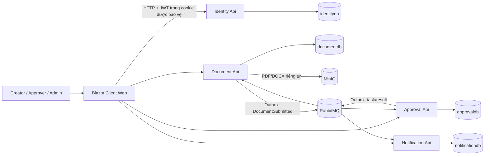
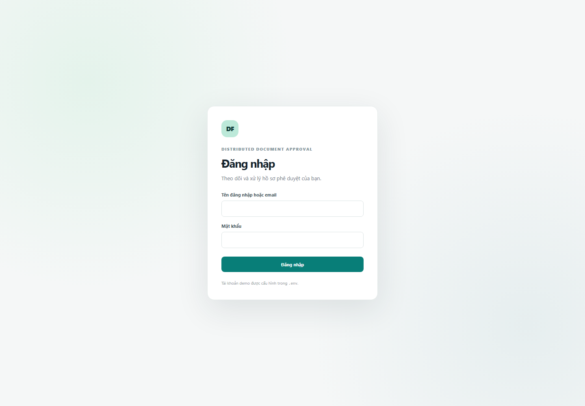

# Distributed Document Approval

Ứng dụng tạo, lưu trữ và phê duyệt tài liệu theo quy trình tuần tự nhiều cấp. Hệ thống dùng .NET 10, bốn ASP.NET Core Minimal API, Blazor Interactive Server, PostgreSQL, RabbitMQ và MinIO-compatible object storage.

## Kiến trúc



| Service | Trách nhiệm | Cổng mặc định |
|---|---|---:|
| `Client.Web` | Blazor UI, phiên cookie, gọi API và proxy tải file | 5200 |
| `Identity.Api` | Đăng nhập, JWT, tài khoản và vai trò | 5111 |
| `Document.Api` | Metadata, quyền đọc, upload/download private file | 5112 |
| `Approval.Api` | Workflow 1–3 bước, quyết định và audit | 5113 |
| `Notification.Api` | Danh sách thông báo, đánh dấu đã đọc | 5114 |
| PostgreSQL | Database riêng cho từng service | 15432 |
| RabbitMQ | Event broker; trang quản trị | 15673 |
| MinIO | Object API và console | 19000 / 19001 |

Mỗi backend sở hữu database riêng. Các event dùng envelope có `EventId` và `CorrelationId`; Outbox ghi cùng transaction nghiệp vụ, Inbox chống xử lý lặp. Event chính: `DocumentSubmitted.v1`, `ApprovalTaskAssigned.v1`, `DocumentApproved.v1`, `DocumentRejected.v1`.

## Chạy bằng Docker Compose

Cần Docker Desktop/Engine có Compose v2. Các cổng host chỉ bind vào `127.0.0.1`.

```powershell
Copy-Item .env.example .env
# Mở .env và đổi các secret trước khi chia sẻ hoặc mở cổng ra mạng.
docker compose up --build -d
docker compose ps
```

Mở giao diện tại <http://localhost:5200>. Compose tự tạo bốn database, áp dụng EF migrations và seed tài khoản demo khi Identity API khởi động lần đầu. Thông tin đăng nhập demo được đặt trong `.env`; chỉ dùng trên máy local.



| Vai trò | Username | Mật khẩu demo trong `.env.example` |
|---|---|---|
| Admin | `admin` | `Admin-Demo-2026!` |
| Creator | `creator` | `Creator-Demo-2026!` |
| Approver | `approver1` | `Approver-One-2026!` |
| Approver | `approver2` | `Approver-Two-2026!` |

`pgsty/minio:RELEASE.2026-08-04T00-00-00Z` là image MinIO-compatible community fork dùng trong Compose ([container tags](https://hub.docker.com/r/pgsty/minio/tags)). Repository MinIO gốc đã được archive ([releases](https://github.com/minio/minio/releases)); hãy đánh giá chính sách hỗ trợ của image trước khi triển khai production. Có thể đổi sang image tương thích khác nếu môi trường đã có MinIO.

### Demo workflow

1. Đăng nhập bằng `creator`, tạo PDF hoặc DOCX, mở tài liệu Draft và chọn 1–3 approver theo thứ tự.
2. Submit tài liệu. Trạng thái chuyển sang Pending; workflow được tạo qua RabbitMQ.
3. `approver1` xử lý bước đầu. Nếu Approve, bước kế tiếp được kích hoạt; nếu Reject, cần lý do và các bước còn lại bị bỏ qua.
4. Creator xem lịch sử quyết định và thông báo kết quả. Có thể chạy thêm luồng để kiểm tra Approved và Rejected.

OpenAPI trong Development: `http://localhost:5111/openapi/v1.json` đến `http://localhost:5114/openapi/v1.json`. Health: `/health/live` và `/health/ready` trên từng API.

## Build và kiểm thử

Cần .NET SDK 10 và Docker để chạy integration tests dùng Testcontainers.

```powershell
dotnet build DistributedDocApproval.slnx
dotnet test DistributedDocApproval.slnx
docker compose config -q
```

Kết quả kiểm thử gần nhất và các kịch bản recovery được ghi tại [docs/05-test-results/TEST_RESULTS.md](docs/05-test-results/TEST_RESULTS.md); nhật ký mốc hiện tại ở [docs/05-test-results/2026-11-24-milestone.md](docs/05-test-results/2026-11-24-milestone.md). Báo cáo nằm trong [docs/07-report/REPORT.md](docs/07-report/REPORT.md). Đặc tả, ma trận quyền, API, ERD logic, lộ trình và Definition of Done nằm trong [DistributedDocApproval_Project_Analysis.md](DistributedDocApproval_Project_Analysis.md).

## Vận hành và dữ liệu

```powershell
docker compose logs -f identity-api document-api approval-api notification-api
docker compose restart document-api
docker compose down
```

`docker compose down` giữ named volumes PostgreSQL, RabbitMQ và MinIO; chạy `docker compose up -d` để khởi động lại. **`docker compose down -v` xóa dữ liệu demo trong các volume.** Sao lưu volume/database/object store trước khi bảo trì dữ liệu cần giữ.

Để xem trạng thái broker khi thử fault recovery, mở <http://localhost:15673>; MinIO console ở <http://localhost:19001>.

## Giới hạn bản demo

- Tài khoản seed và secret trong `.env.example` chỉ phục vụ demo local. Thay secret, signing key và mật khẩu trước khi dùng chung; không public các cổng development.
- HTTP chỉ dùng trên loopback trong Compose này; chưa cấu hình TLS, SSO, email, quét mã độc, sao lưu tự động hoặc lưu trữ audit ngoài database.
- Upload giới hạn 10 MiB và chỉ nhận PDF/DOCX hợp lệ theo validator dự án.
- RabbitMQ cung cấp giao nhận at-least-once; Outbox/Inbox xử lý gửi lại và trùng event, không cam kết exactly-once xuyên nhiều database.
- MinIO image hiện tại là community fork tương thích S3; đánh giá chính sách hỗ trợ và cập nhật image trước khi triển khai production.
