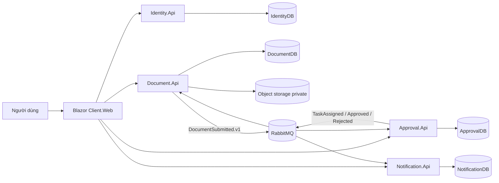
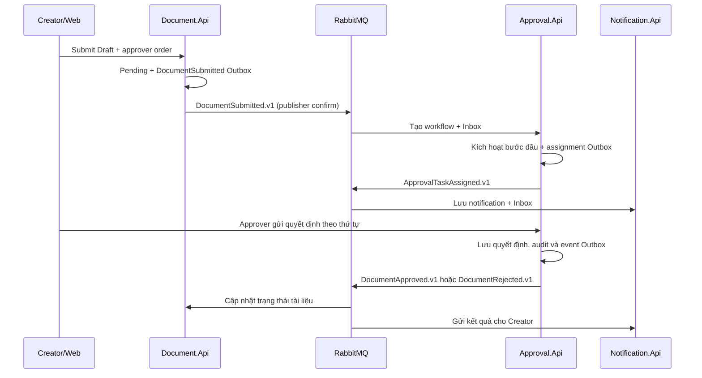

# Báo cáo dự án — Distributed Document Approval

## Chương 1 — Tổng quan

Distributed Document Approval quản lý tài liệu cần nhiều người phê duyệt. Creator tải tài liệu lên và chọn một đến ba Approver theo thứ tự. Mỗi người chỉ xử lý task khi đến lượt. Quy trình kết thúc ở Approved hoặc Rejected; Creator xem lại lịch sử và nhận thông báo.

Phạm vi hiện thực là bản MVP chạy local: bốn backend .NET 10, Blazor UI và các dependency được dựng bằng Docker Compose. Có ba vai trò Admin, Creator, Approver. Admin quản lý tài khoản nhưng không thể tự quyết định task.

## Chương 2 — Yêu cầu và quy tắc nghiệp vụ

- Creator tạo, đọc, cập nhật và xóa Draft của mình; chỉ submit tài liệu Draft còn đúng version.
- File PDF/DOCX private, giới hạn 10 MiB. Tài liệu do người tạo sở hữu; Approver được cấp quyền đọc khi được đưa vào workflow.
- Submit yêu cầu từ một đến ba approver đang hoạt động. Mỗi bước chỉ Active sau khi bước trước Approve.
- Reject phải có lý do. Khi bị Reject, các bước chờ còn lại chuyển Skipped và workflow dừng.
- Approver khác, người ngoài workflow và Admin không được quyết định thay người được giao.
- Cập nhật bước dùng điều kiện trạng thái Active trong câu lệnh cập nhật dữ liệu; hai request đồng thời chỉ một kết quả thắng.

## Chương 3 — Kiến trúc

Mỗi backend sở hữu dữ liệu của mình và không đọc trực tiếp database của service khác. Blazor gọi REST qua các service URL trong cấu hình. Các API xác thực JWT và kiểm tra role cùng quyền tài nguyên. Web server giữ access token trong ticket cookie được bảo vệ và proxy download; trình duyệt không nhận bearer token.

Luồng sự kiện:

Outbox đóng event trong transaction nghiệp vụ để tránh mất sự kiện sau khi database đã commit. Publisher dùng persistent message và publisher confirms. Consumer ack sau khi handler commit; Inbox unique theo EventId để event giao lặp không tạo bản ghi lặp. Đây là giao nhận at-least-once với xử lý idempotent, không phải transaction exactly-once xuyên nhiều database.

## Chương 4 — Dữ liệu và API

| Database | Bảng/chức năng chính |
|---|---|
| IdentityDB | `Users`, role, trạng thái tài khoản, hash mật khẩu. |
| DocumentDB | `Documents`, `DocumentReaders`, `OutboxMessages`, `InboxMessages`; file nằm trong object storage private. |
| ApprovalDB | `Workflows`, `ApprovalSteps`, `ApprovalDecisions`, Outbox/Inbox. |
| NotificationDB | `Notifications`, Inbox xử lý event lặp. |

Các nhóm endpoint: `/api/auth` và `/api/users`; `/api/documents`; `/api/approvals`; `/api/notifications`. API trả Problem Details hoặc validation response, dùng `409 Conflict` cho version/trạng thái/order xung đột và `422` cho dữ liệu nghiệp vụ không hợp lệ. OpenAPI được bật trong môi trường Development.

## Chương 5 — Triển khai

Mỗi ứng dụng .NET có Dockerfile multi-stage và chạy bằng user không phải root. `docker-compose.yml` khởi chạy web, bốn API, PostgreSQL, RabbitMQ và MinIO-compatible storage. Cấu hình đến từ environment variables; `.env.example` chỉ phục vụ demo local. PostgreSQL tạo database theo từng service; EF migrations chạy khi service khởi động. Named volumes giữ dữ liệu khi dừng stack.

Hướng dẫn dựng hệ thống, cổng, tài khoản demo và vận hành nằm trong [README.md](../README.md). Đặc tả nguồn có ma trận quyền và ERD logic trong [DistributedDocApproval_Project_Analysis.md](../DistributedDocApproval_Project_Analysis.md).

## Chương 6 — Kiểm thử và đánh giá

`dotnet build` đạt 0 warning/0 error. `dotnet test` đạt 15 test: 8 unit tests và 7 integration tests dùng PostgreSQL Testcontainers. Test bao phủ identity, xác thực PDF, upload/download đúng bytes, quyền sở hữu file, workflow tuần tự, sai thứ tự, quyết định trùng/đồng thời, quyền Admin và Inbox notification. Một clone sạch từ GitHub `main` cũng restore/build/test và chạy đủ tám service bằng Compose.

Smoke test Compose xác nhận luồng Approved hai cấp, Reject có lý do, thông báo và cookie đăng nhập HttpOnly. Khi Notification API dừng, quyết định vẫn hoàn tất và notification được giao sau khi service hoạt động. Khi RabbitMQ dừng, Submit còn trong Outbox; sau khi bật broker, worker phát lại. Kịch bản này cũng phát hiện rồi kiểm tra bản vá consumer tự đăng ký lại sau broker restart.

Kết quả lệnh và từng kịch bản cụ thể nằm trong [TEST_RESULTS.md](../05-test-results/TEST_RESULTS.md); snapshot runtime ở [runtime-status.txt](../05-test-results/runtime-status.txt). Bộ ảnh gồm login, OpenAPI, dashboard, inbox hai Approver, timeline Approved/Rejected, notifications, RabbitMQ queues, Compose status và log sau khi Notification API phục hồi; xem [docs/06-screenshots](../06-screenshots/README.md). Ảnh Compose là output CLI thật được render để dễ đọc, không phải ảnh Docker Desktop UI.

## Chương 7 — Kết luận và giới hạn

MVP đáp ứng kiến trúc microservices, phân quyền theo vai trò và tài nguyên, phê duyệt tuần tự, event-driven notifications, Outbox/Inbox, health checks và Compose. Phạm vi hiện tại chưa có TLS, SSO, email, antivirus, backup tự động hoặc triển khai HA. Cần thay secret demo, cấu hình TLS/backup/monitoring và đánh giá chính sách image trước khi triển khai production. Workflow, notifications, RabbitMQ queues, Compose status và chuỗi outage/recovery đều có ảnh runtime; log recovery được lưu riêng.
